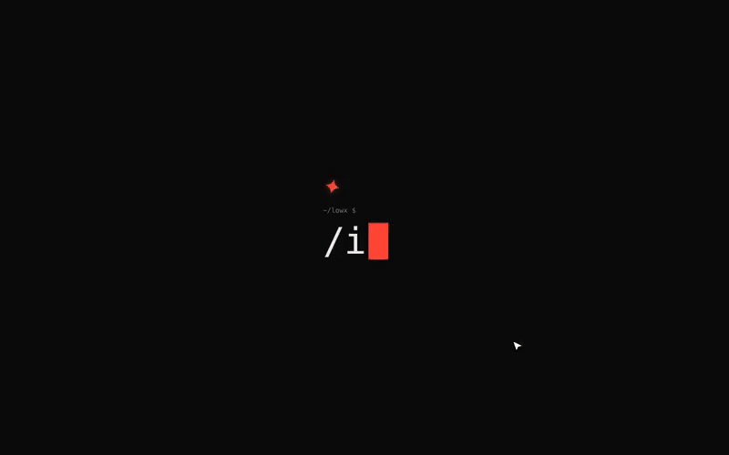

# orbit ✦

> The personal landing page of me, **lowx**, fullstack developer. It builds itself: type `/init`, and a small team of cursors draws, types and drags every piece of the page into place, then settles into an orbit around your mouse.

**Live demo:** https://samlcss.github.io/orbit/



---

## ✦ What happens

1. **`/init`**: the page starts as a terminal prompt. Press <kbd>Enter</kbd> or click to boot.
2. **The star**: a big signature star appears, eight cursors burst out of it like sparks, and it fades away after two seconds.
3. **The build**: the eight cursors build the page live, piece by piece:
   - draw a selection box with its size (`324 × 41`) around each element,
   - type or *decrypt* the text,
   - drag blocks from off-position into place,
   - draw the divider lines from left to right.
4. **The signature**: the star next to the name is built last, with a pop and three rings. Ten more cursors spring out of it and join the others.
5. **The orbit**: all 18 cursors orbit the mouse clockwise, each at its own pace. Move the mouse and they glide after it, then slip back into the ring.

## ✦ Things to try

| Action | What it does |
|---|---|
| Hover the name | All three hero lines decrypt into a hidden message, with a typing caret running along. The star sends a pulse when it's done. |
| Click on empty space | The cursors draw a shape around the click and it fills in: ✦ star → ♥ heart → ∞ infinity → 〰 wave → △ triangle → @ spiral |
| Go near a link | The orbit tightens a little, as if focusing on it |
| `talk to me on discord` | Copies the Discord username to the clipboard |
| `◐ light / dark` | Switches theme. The cursors and the star fade from red to pastel |
| `skip` / `rebuild` / `1x` | Controls in the bottom bar: skip the build, run it again, or speed it up (1x / 2x / 4x) |

## ✦ Built with

Plain **HTML, CSS and JavaScript**. No frameworks, no libraries, no build step.

- **HTML**: the page structure (`index.html`)
- **CSS**: layout, light/dark themes, star glow and pulse, the blinking caret (`style.css`)
- **JavaScript**: the build engine, cursor physics, text decryption and shape drawing (`script.js`)
- Fonts: Helvetica Neue / Helvetica / Arial and [JetBrains Mono](https://www.jetbrains.com/lp/mono/) (Google Fonts)

### How the cursors move

- **Building**: each cursor takes the next free piece from a queue, ordered top to bottom. A piece can start once the piece that contains it exists. Cursors with nothing to do go and "help" around a piece someone else is working on, so nobody stands still.
- **Orbit**: every cursor has its own orbit centre that follows the mouse with a critically damped spring, which gives smooth catch-up with no jerk or overshoot. It rides a ring around that centre. If two cursors get too close, the one behind eases off and the one ahead speeds up, so the ring never clumps.
- **Shapes**: each shape is a parametric curve sampled at equal distances, one point per cursor. The filled area is the same curve drawn as an SVG path.

## ✦ Project structure

```
orbit/
├── index.html   # page structure and texts
├── style.css    # visual style and themes
├── script.js    # all the animation logic
├── preview.gif  # the demo above
└── README.md
```

## ✦ Run it locally

No install needed.

- **VS Code**: open the folder, right-click `index.html` → **Open with Live Server**
- **Or** just open `index.html` in your browser

An internet connection is only needed for the JetBrains Mono font.

## ✦ Make it yours

| What | Where |
|---|---|
| Name, hidden message, `//` lines | `index.html`: the `data-alt` attributes in `.hero` hold the hidden texts |
| Bio, "what i do", links | `index.html` |
| Discord username copied by the button | `script.js`: `copyText('lowx.gg')` |
| Accent colour (dark / light) | `style.css`: `--acc` in `:root` and in `body.light` |
| Number of cursors | `script.js`: `const N=18,B=8` (total / how many build) |
| Build speed | `script.js`: `const D=ms=>ms*1.75/speed` (lower = faster) |
| Pastel cursor colours | `script.js`: `PASTEL` |
| Click shapes | `script.js`: `SHAPES` (add any parametric curve) |

## ✦ Inspiration

- A video of a portfolio being assembled live by AI agents
- [piqs.eu](https://piqs.eu/) and [xs10.dev](https://xs10.dev/) for the idea of a small personal landing page
- [hakaisecurity.io](https://hakaisecurity.io/) for the `// comment` code aesthetic
- *Death Stranding*'s "like" heart, for the filled shapes

---

<p align="center">✦ made by <b>lowx</b> · <i>// driven by dreams</i></p>
